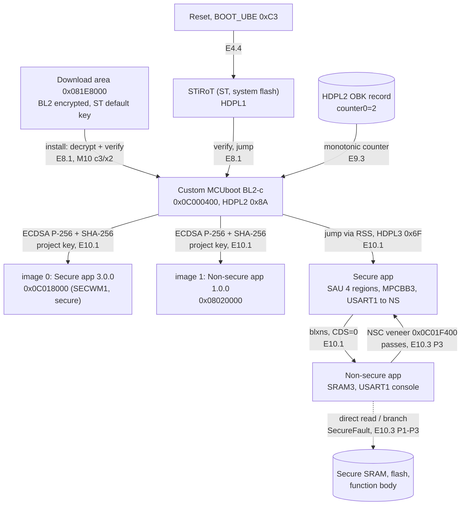
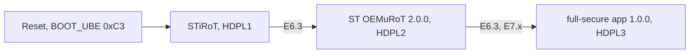

# X7: architecture as verified on the board

Only arrows with board evidence are drawn. Each arrow carries the evidence ID; the files are listed below. Board state: STM32H573I-DK, Open, TZEN 0xB4, BOOT_UBE 0xC3 (X2).

## Final chain (M8-M10)

Rejections seen on the board (not drawn as paths):

- BL2 refuses an image with a changed hash (M3 case 2 primary, case 3b secondary; M10 T1 S, T3 NS) or another signing key (M3 case 4), and an image whose security counter is below the OBK record (M9 B4, B5). With two images, one bad image stops both (M10 T3).
- STiRoT does not install a tampered download image (M5 E5.2).
- When BOOT0 (SW1) is 0 the BL2 runs at HDPL1 and stops itself (`hdpl=0x51, not started by stirot: stop`), the path every board write used.

## ST reference chain (M6-M7 baseline)

## Memory map used by the final chain

| Area | Address | Attribute | Content |
|---|---|---|---|
| STiRoT execution area | 0x0C000000-0x0C017FFF | Secure (SECWM1) | BL2-c (STiRoT header at 0x0C000000, code at 0x0C000400) |
| image 0 primary | 0x0C018000-0x0C01FFFF | Secure (SECWM1) | Secure app, NSC veneer at 0x0C01F400-0x0C01F7FF |
| image 1 primary | 0x08020000-0x0802FFFF | Non-secure (SAU) | Non-secure app |
| Download area | 0x081E8000-0x081FFFFF | | STiRoT download slot (encrypted BL2) |
| SRAM, secure alias | 0x30000000-0x3009FFFF (BL2), 0x30000000-0x3003FFFF (Secure app, SRAM1) | Secure | BL2 RAM, then Secure app RAM |
| SRAM3 | 0x20050000-0x2009FFFF | Non-secure (SAU, MPCBB3) | Non-secure app RAM |
| HDPL2 OBK | 0x0FFD0B10 | | rollback record (M9) |

## Evidence

| ID | File |
|---|---|
| E4.4 | `m4-stirot/README.md` |
| E5.2 | `m5-stirot-tamper/` |
| E6.3, E7.x | `m6-stirot-oemurot/2026-10-05-m6-e63-integrated-boot.txt`, `m7-chain-tamper/` |
| E8.1 | `m8-custom-chain/` |
| E9.3 | `m9-update-rollback/2026-10-06-m9-b2-b3.txt`, `-m9-b4.txt`, `2026-10-07-m9-b5.txt` |
| E10.1-E10.3 | `m10-trustzone/2026-10-09-m10-result.txt` |
| X2 | `x2-security-config/README.md` |
